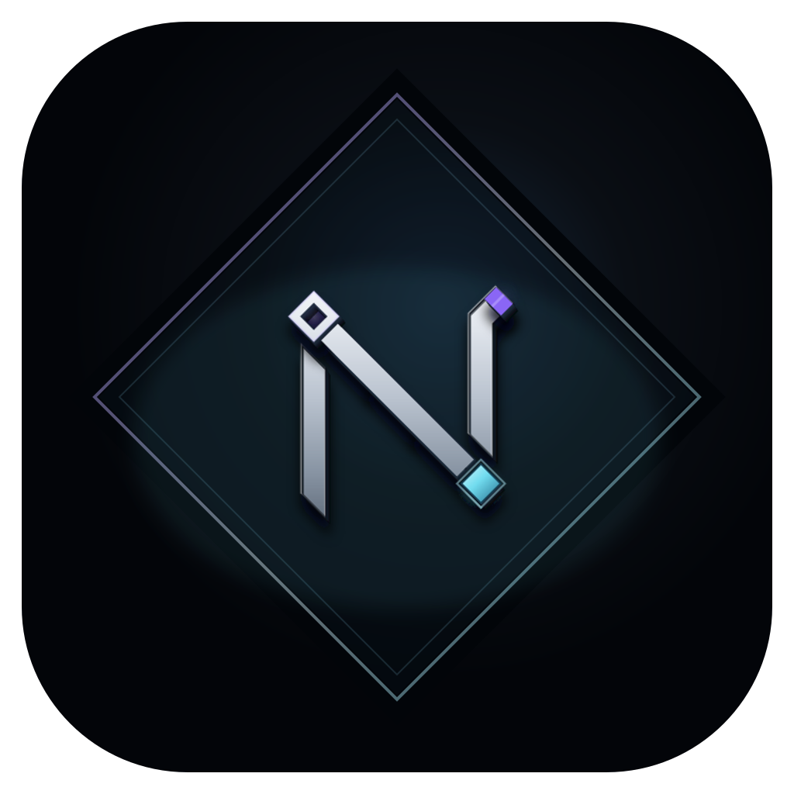
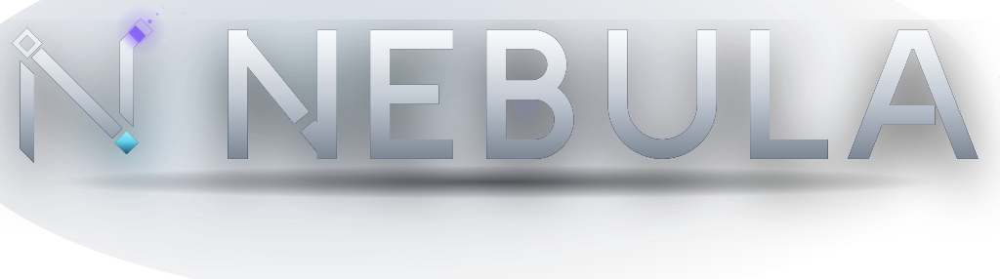
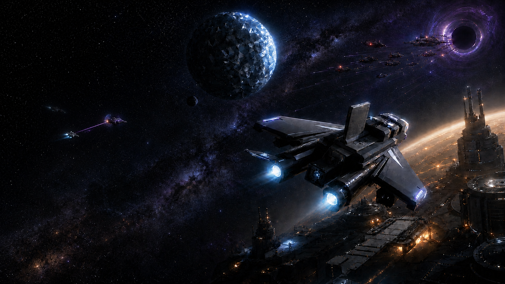
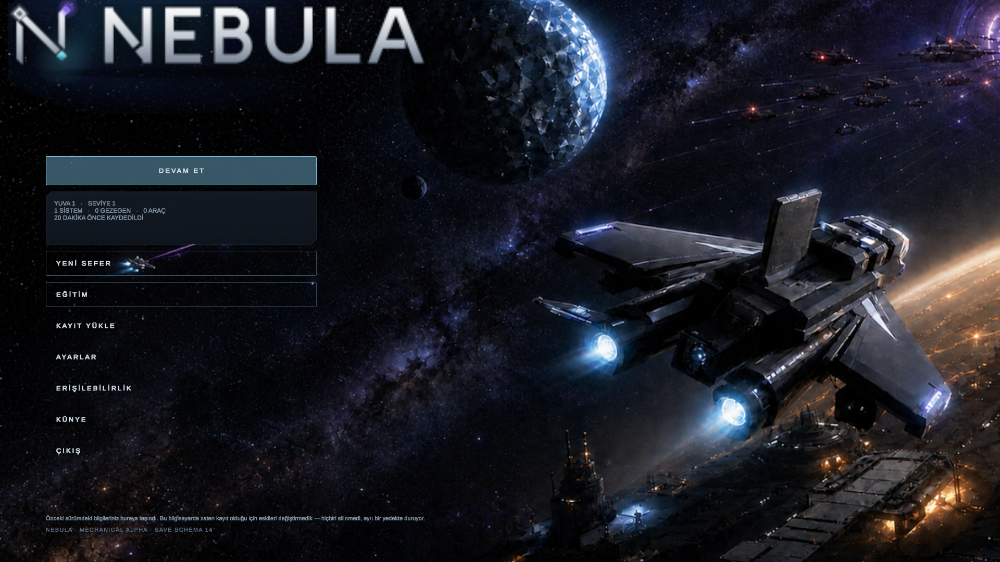
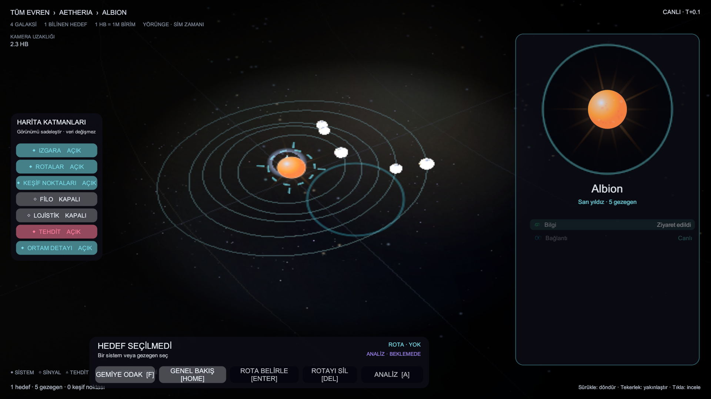
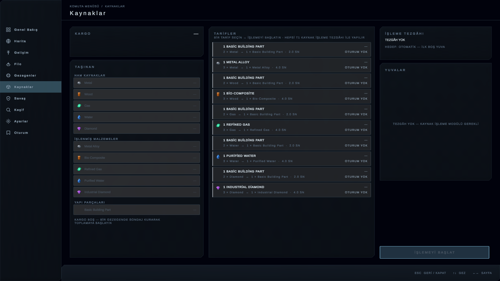
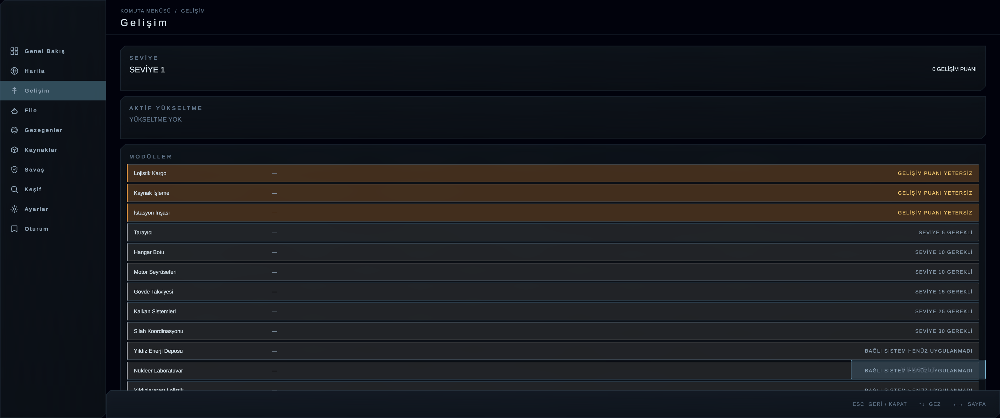
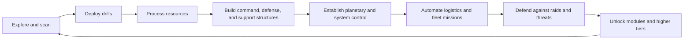
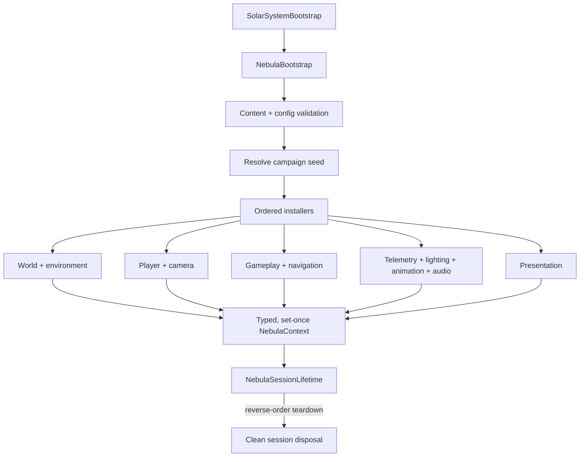

<p align="center">
  
  &nbsp;&nbsp;&nbsp;
  
</p>

<p align="center">
  
</p>

NEBULA is a single-player space exploration, extraction, logistics, and territorial-control game built with Unity and C#. The player manually crosses a deterministic open galaxy, develops planetary infrastructure, operates a support fleet, and defends controlled systems against escalating threats.

> **Status:** private alpha / portfolio source snapshot. This repository presents the original gameplay code, tests, engineering documentation, selected brand exports, and approved screenshots. Distributable builds and unresolved-provenance visual assets are intentionally not included.

<p align="center">
  
</p>

<p align="center">
  
  
  
</p>

## Core gameplay



## Feature set

- Six-axis manual flight, boost, deep-space cruise, gravity, and floating-origin precision management
- Seeded sector/system generation with immutable manifests and reproducible IDs
- Full/Warm/sparse system streaming with deterministic remote simulation
- Five resource families: Metal, Wood, Gas, Water, and Diamond
- Planet scanning, drilling, instant recipe processing, cargo, and storage systems
- Surface command, defense, drill, support, maintenance, and upgrade workflows
- Planetary control, system dominance, evacuation, and reclaim flows
- Orbital logistics centers, collector routes, and resource transfers
- Scout, Collector, Engineer, and Escort vehicles with physical missions and Mk upgrades
- Shield/armor/hull combat with Laser, Plasma, and EM weapon profiles
- Encounters, pirate bases, raids, salvage, repair, emergency shutdown, and intervention groups
- Strategic map, navigation knowledge, signals, routes, POIs, anomalies, wrecks, and facilities
- Level 1–100 progression and T1–T5 ship modules
- Eleven tutorial chapters spanning flight through campaign/session management
- Three save slots, three rotating backups per slot, migration, integrity checks, and autosave
- Turkish-first UI, configurable input, accessibility cues, local telemetry, diagnostics, and release tooling

See [Feature map](docs/FEATURES.md) for the domain-by-domain breakdown.

The project identity uses a modular emblem, an extended NEBULA wordmark, and cinematic key art. Their repository roles and usage boundaries are documented in the [brand guide](docs/BRAND.md).

## Architecture

NEBULA uses an explicit composition root. `NebulaBootstrap` validates content and configuration, resolves the campaign seed, then runs installers in a fixed order. Dependencies are written once into a typed `NebulaContext`; partial boots unwind through `NebulaSessionLifetime` rather than leaving a half-built world behind.



The domain source is organized under `Assets/Scripts/Nebula/` into focused modules such as `Sectors`, `Extraction`, `Combat`, `Hangar`, `Logistics`, `Navigation`, `Progression`, `Tutorial`, `UI`, and `World`.

Detailed diagrams and ownership rules are in [Architecture](docs/ARCHITECTURE.md).

## Deterministic world model

Immutable generated data is separated from mutable campaign history. A system manifest can always be regenerated from the campaign seed and coordinates; only its delta needs to be saved.

```mermaid
flowchart LR
    Seed["Campaign seed"] --> Hash["FNV-1a + mixed hash channels"]
    Hash --> Sector["SectorManifest"]
    Sector --> System["SystemManifest"]
    System --> Materialize["Full or Warm materialization"]
    Delta["SystemDelta: scans, structures, fleets, combat"] --> Materialize
    Materialize --> Capture["Capture mutations"]
    Capture --> Delta
    Delta --> Save["Versioned save envelope"]
    Save --> Restore["Validate, migrate, restore"]
    Restore --> Delta
```



See [Algorithms](docs/ALGORITHMS.md) for generation, LRU caching, streaming, sparse ticks, floating origin, progression, combat, and save integrity.

## Engineering profile

| Area | Current snapshot |
| --- | ---: |
| Runtime C# files | 491 |
| Runtime C# lines | 114,577 |
| Editor C# files | 24 |
| Test C# files | 375 |
| Test declarations | 3,908 |
| Test C# lines | 117,849 |
| Unity version | 2022.3.22f1 |
| Save schema | v15 |
| Platforms targeted by the private project | macOS, Windows |

The test suite spans EditMode and PlayMode assemblies. It covers pure domain rules, content validation, save migration, composition/lifetime ownership, streaming, remote simulation, UI behavior, tutorials, performance gates, and release regressions.

## Repository map

```text
Assets/
├── Scripts/Nebula/   # runtime gameplay and presentation code
├── Editor/Nebula/    # build, import, catalog, and scene tooling
└── Tests/            # EditMode and PlayMode suites
Packages/             # Unity package manifest and lock file
ProjectSettings/      # engine version and sanitized configuration snapshot
Tools/                # test gates, distribution, fonts, and smoke tooling
docs/                 # brand, architecture, algorithms, features, screenshots
```

## Public snapshot boundary

This is intentionally not a runnable or redistributable game package. The private working project contains binary media whose public-distribution provenance has not yet been fully resolved. Apart from the three selected brand exports and approved gameplay screenshots used by this portfolio, those files, generated Unity directories, release builds, raw audits, and internal planning artifacts are excluded here.

The source is published for portfolio review only. No open-source license or reuse grant is provided; see [NOTICE](NOTICE.md) and [third-party notices](THIRD_PARTY_NOTICES.md).

## Current limitations

- Private alpha; not a store release
- Turkish-only player-facing localization in the current build
- Windows build output exists in the private project but has not been runtime-verified on Windows
- Long-duration soak/performance validation and asset-license closure remain release gates
- This public snapshot cannot build without the omitted private/provenance-gated assets
