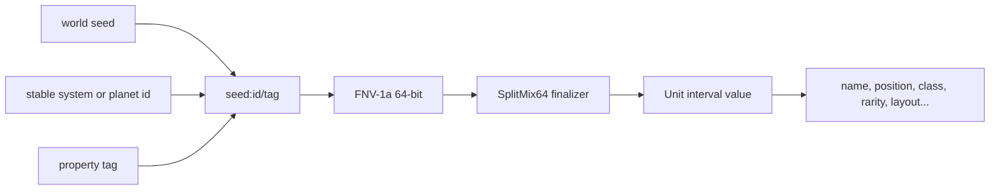
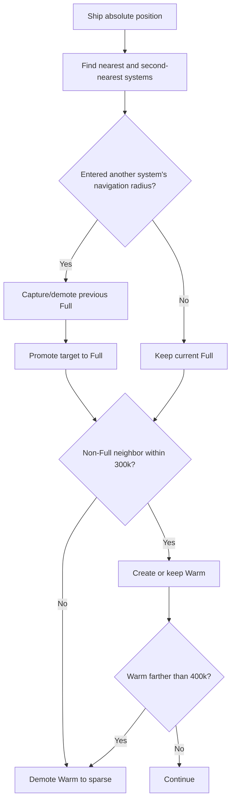
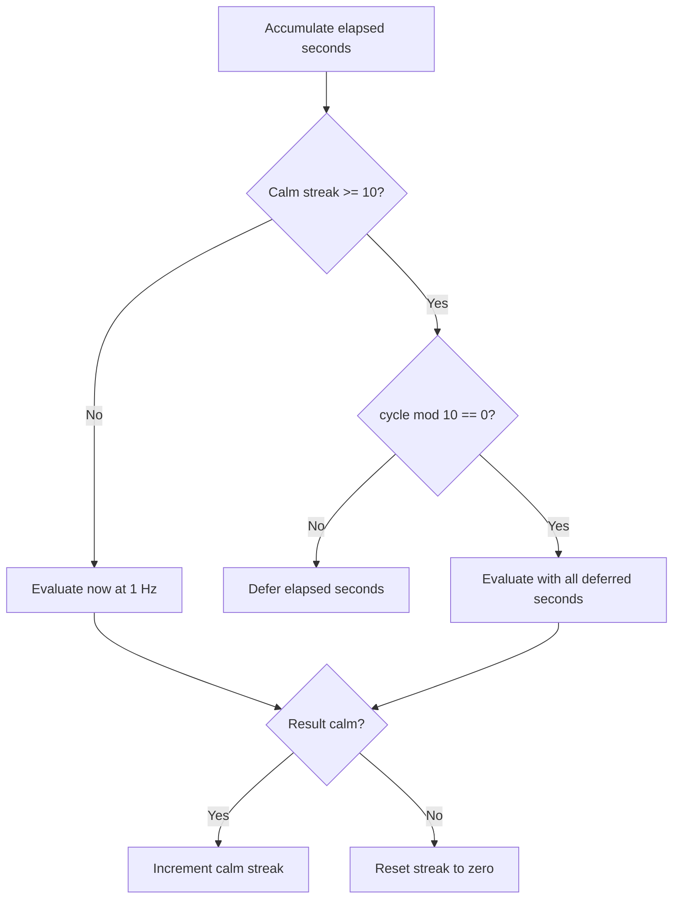
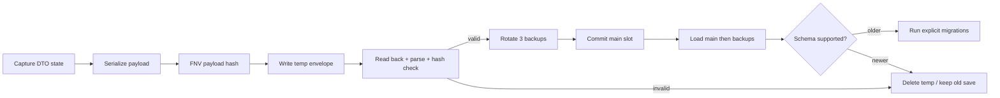

# Algorithms and data flows

## Deterministic generation

Generated content uses stable, tagged hash channels instead of advancing one shared random stream. `ExtractionCatalog.Hash` implements 64-bit FNV-1a over the input string; `Unit01` applies a SplitMix64-style finalizer and maps the upper 53 bits to `[0, 1)`.



Independent tags mean asking for one property does not change later properties. A manifest is a pure function of seed, generation version, and coordinate.

## Bounded sector cache

`SectorManifestRepository` uses deterministic least-recently-used eviction.

- default capacity: 512 sectors
- minimum capacity: 28 (27-sector live neighborhood + pinned start sector)
- most recently resolved at the front
- least recently used at the back
- start sector is never evicted
- mutable deltas are stored elsewhere and therefore never lost with a cache eviction

Cache lookup and touch are constant-time through a dictionary plus linked-list node. Eviction removes the matching manifest and its secondary system-ID index entries.

## System streaming

The streaming director calculates absolute ship position as local position plus floating-origin offset, then evaluates nearby systems.



Full systems run normal GameObject simulation. Warm systems keep prepared presentation state. Sparse systems operate entirely on DTO/delta state.

## Sparse remote scheduler

The remote base cycle is one second.

- busy system: evaluate every cycle (1 Hz)
- calm system: after 10 consecutive calm evaluations, evaluate one cycle in 10 (0.1 Hz)
- skipped seconds are accumulated and passed to the next evaluation
- a busy result immediately resets the calm streak



This changes evaluation cost, not simulated time or difficulty. There is intentionally no offline progression.

## Floating origin

When the ship exceeds 200,000 local units from the origin:

1. take the ship’s current local position as the rebase offset;
2. shift every spatial scene root by the negative offset;
3. add the offset to the static absolute-position accumulator;
4. clear trails that cannot have their existing points translated;
5. translate world-space particle positions;
6. notify listeners through `OriginShifted`.

Relative geometry and physics are unchanged while 32-bit float precision is recovered near `(0,0,0)`.

## Save integrity and migration

The save envelope contains schema version, generation version, campaign identity, revision, timestamp, FNV payload hash, and the JSON payload.



The payload hash detects accidental corruption; it is not a cryptographic signature or anti-tamper mechanism. Schema v15 migrates the legacy timed processor state into the current instant processing bench model.

## Progression curve

The XP required to move from level `L` to `L + 1` is:

```text
roundToNearest10(100 + 20L + 2L²)
```

Total XP for a level is the sum of all previous level costs. Level is always derived from total XP and clamped to 1–100. Awards use stable event IDs so first-time events remain idempotent after save/load.

## Layered combat

Damage cascades through Shield → Armor → Hull. Weapon families apply different per-layer multipliers:

| Family | Shield | Armor | Hull |
| --- | ---: | ---: | ---: |
| Neutral | 1.00 | 1.00 | 1.00 |
| Laser | 1.00 | 0.65 | 1.25 |
| Plasma | 0.70 | 1.50 | 1.15 |
| EM | 2.00 | 0.35 | 0.50 |

All consumers route through the same `DamageResolver` and `Durability.ApplyDamageWithProfile` path, preventing ship weapons, defenses, and collisions from drifting into separate damage rules.

## Extraction rates

Resource family, rarity, and drill tier determine yield. T2 uses one shared rule on both Full and remote paths:

```text
T2 production = T1 effective production × 1.5
T2 storage = T2 production per second × 900 seconds
```

The shared catalog functions ensure a drill produces and stores the same amount whether its system is currently materialized or simulated remotely.
