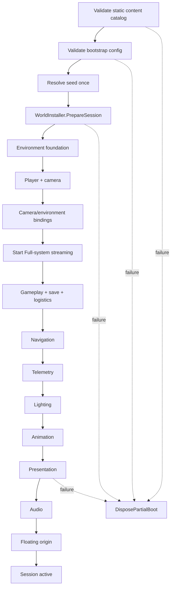
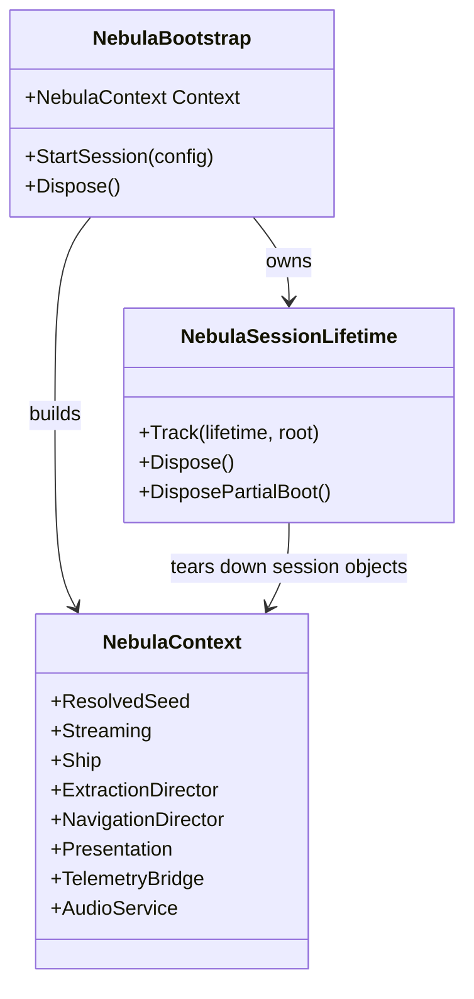
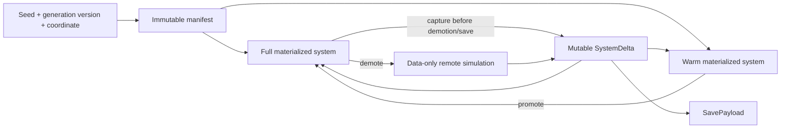
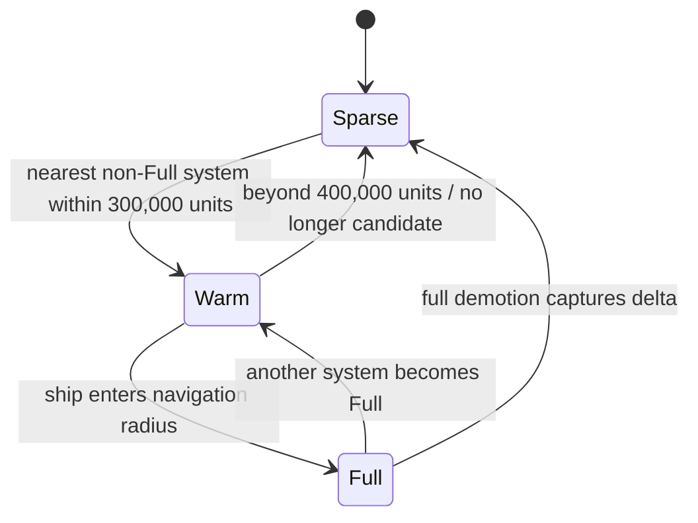
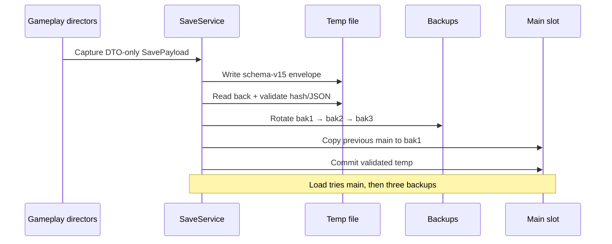

# Architecture

NEBULA separates campaign composition, immutable universe descriptions, mutable campaign deltas, materialized Unity objects, and presentation. This keeps the same gameplay state authoritative whether a system is visible, warm, or simulated remotely.

## Composition root

`NebulaBootstrap.StartSession` is the single owner of boot order.

Every installer receives the same typed context and lifetime tracker. Dependencies are never discovered by installer-to-installer scene searches.

## Typed context

`NebulaContext` is a non-generic, named dependency bag. Each property:

- has a concrete type and descriptive name;
- can be set exactly once;
- throws if read before wiring;
- throws on a second write;
- represents only the current campaign session;
- is not serialized and is not a second gameplay-state authority.

## Lifetime model

| Lifetime | Owner | Examples |
| --- | --- | --- |
| Application | scene/application | scene adapter and inspector config |
| Campaign session | `NebulaSessionLifetime` | seed, ship, directors, repositories, save/navigation |
| Materialized system | `SystemStreamingDirector` | Full/Warm stars, planets, structures, POIs, encounters |
| Transient UI | `NebulaSessionLifetime` / presentation | HUD, screens, modals |

Disposal runs transient UI first, campaign roots second, then runtime-created materials/meshes/textures and process-wide static state. Calls are idempotent.

## World truth model

### Immutable manifests

`SectorManifest`, `SystemManifest`, `PlanetManifest`, and `PoiManifest` describe generated content. They are reproducible and therefore are not frozen into each save.

### Mutable deltas

`SystemDelta` stores changes layered over a manifest: scans, drills, structures, dominance, planet snapshots, vehicles, logistics, routes, POIs, combat state, pressure, intervention groups, pending attacks, and reconnect summaries.

Ship-owned state remains with the ship save rather than moving between system deltas.

## Streaming state machine

Only one system is Full and at most one additional system is Warm. Other known systems with mutable work are data-only and scheduled remotely.

## Save and restore

Newer schemas are rejected. Older supported payloads are migrated after load. Save/test tooling can redirect its data root so automated runs never overwrite player saves.

## Domain boundaries

| Namespace | Responsibility |
| --- | --- |
| `World`, `Sectors`, `Simulation` | universe, gravity, manifests, materialization, streaming |
| `Ship`, `Navigation` | flight, input, cruise, routes, discovery |
| `Extraction`, `Logistics` | resources, drills, structures, control, transfers |
| `Hangar`, `Remote` | vehicles, missions, routes, distant simulation |
| `Combat` | durability, weapons, encounters, raids, repair, salvage |
| `Progression`, `Modules` | XP curve, milestones, ship upgrades |
| `Poi`, `Tutorial` | exploration content and guided curriculum |
| `UI`, `Visuals`, `Audio` | presentation-only concerns |
| `Content` | validated static definitions and runtime catalog |
| `Telemetry`, `Diagnostics`, `Platform` | local observation, gates, paths, migrations |

## Testability

Pure types handle progression math, hash-derived generation, remote scheduling, economic rules, damage profiles, and many state transitions. Unity-facing installers and presentation are covered separately in PlayMode. This split allows deterministic rule tests without scene discovery or frame timing wherever a Unity object is unnecessary.
