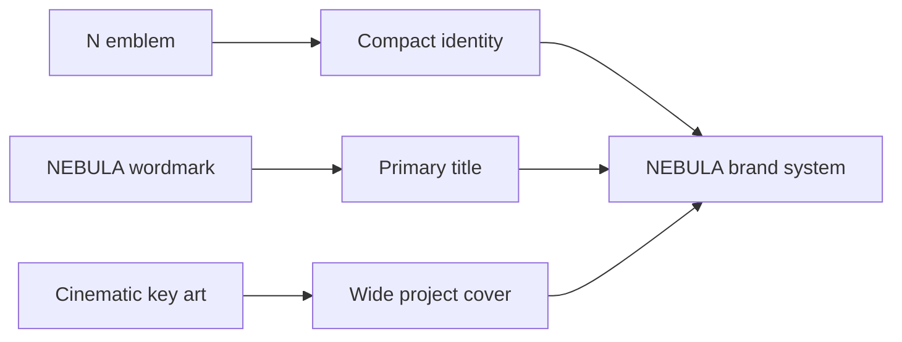

# NEBULA brand

The repository uses three approved project exports as a consistent identity system. They are presentation assets, not a general-purpose asset pack.

## Primary assets

| Asset | Role | Repository use |
| --- | --- | --- |
| `nebula-icon.png` | Standalone NEBULA emblem | Compact project identity, avatars, and square placements |
| `nebula-wordmark.png` | Full NEBULA name lockup | Primary title treatment on dark backgrounds |
| `nebula-cover.png` | Cinematic key art | Wide hero image and project cover |

## Composition

The README presents the emblem and wordmark first, followed by the clean key art. The cover intentionally contains no embedded title, preventing duplicate wordmarks and keeping the hierarchy clear across desktop and mobile GitHub layouts.

## Usage boundaries

- Preserve the original aspect ratio and internal spacing.
- Use the wordmark and emblem on dark backgrounds where their silver, violet, and cyan details remain legible.
- Do not recolor, redraw, stretch, or separate elements inside either lockup.
- Do not add gameplay text or badges directly onto the clean key art.
- These files are included for identification and portfolio presentation only; see the repository [notice](../NOTICE.md).
